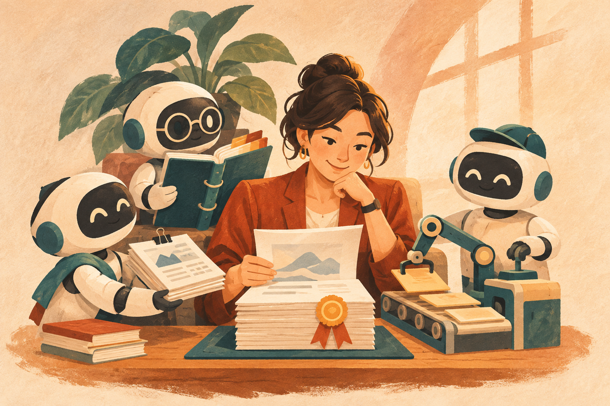

未來最有競爭力的人，不一定是最會寫提示詞的人，而是最懂得管理 AI 團隊的人。

最近看到 Lauren Tan 分享 Grok Bot 的使用與團隊管理觀念，看完之後，我最大的感想是：**我們是不是一直把 AI Agent 當成工具，卻忘了它其實更適合用管理員工的方式來安排工作？**

過去使用 ChatGPT，我們習慣問一個問題、得到一個答案。後來有了 Claude Code、Codex，我們開始讓 AI 幫忙寫程式、整理資料、製作報表。現在進入 AI Agent 時代，AI 不只能回答問題，還能使用工具、執行任務；搭配平台支援的排程或事件觸發機制，也能在授權範圍內啟動例行工作。

這時候，真正重要的能力已經開始改變。不是你會使用多少 AI 工具，而是你能不能建立一套讓 AI 持續替你工作的系統。

> 本文以 Lauren Tan 分享的管理觀念為起點，結合我對 AI Agent 工作流的實務思考，並非原指南的逐條翻譯。文中的角色、訂單與課程流程是說明用的設計情境，不代表每套平台都能直接完成。Skills 與 Routines 的基本機制可參考 [Grok Bot 官方工作指南](https://prod.cursor.com/docs/grok-bot/work)。

<!-- more -->

## 一、AI 員工不是越多越好，如何讓分工更清楚？

從這些分享中，我讀到一個很重要的觀念：與其建立一大群 Bot，不如先把少數幾個 Bot 的工作做好。

這點我非常認同。以前我們在研究 Multi-Agent 多代理架構時，很容易陷入一個迷思：既然可以建立很多 Agent，那是不是每個工作都應該有一個專屬 Agent？

行銷一個、寫文章一個、查資料一個、寫程式一個、管理信箱一個……最後建立了十幾個 Agent，卻發現自己每天光是決定要找誰工作，就已經很累了。

這跟管理真實員工很像。員工越多，不代表生產力越高。如果沒有清楚的職責、工作流程與管理制度，反而會增加溝通成本。

我認為比較合理的做法，是先建立幾個核心角色：

| AI 角色 | 主要職責 | 可以驗收的交付物 |
| --- | --- | --- |
| AI 幕僚長 | 任務管理、進度追蹤與工作分派 | 任務清單、負責角色與進度摘要 |
| AI 研究員 | 蒐集資訊、研究技術與驗證資料 | 附來源的研究筆記與待確認事項 |
| AI 內容編輯 | 文章、社群貼文與行銷素材 | 可審閱的內容草稿 |
| AI 工程師 | 開發工具、建立自動化流程 | 可執行的程式與驗證紀錄 |

甚至不一定需要四個獨立的 Bot。如果系統能妥善管理角色、上下文與權限，也可以由一個主要 Agent，根據任務切換不同的專業角色。

但角色切換不等於權限隔離。如果不同工作需要不同的資料存取或核准規則，仍要確認平台能否真正限制權限。

**重點從來不是 Agent 的數量，而是工作能不能被正確完成。** 如果你還在釐清聊天工具與代理的差異，可以先閱讀[AI 聊天機器人與 AI Agent 的差別](/posts/ai-chatbot-vs-agent-difference-and-how-to-use/)。

## 二、如何把 AI 的成功經驗，整理成可重用的 Skills？

這是我特別喜歡的觀念：當你教 Bot 執行某項任務時，可以要求它把成功的工作流程整理成 Skills。

為什麼？因為 AI 有一個很常見的問題：今天教會它的事情，過了一段時間，換個對話或執行環境，可能又得重新說明。尤其當工作涉及很多細節時，光靠一大段提示詞，很難保證每次執行都一致。

這時候，Skills 就非常有價值。

例如，我經常需要將 AI 技術研究整理成部落格文章，再改寫成 Facebook 粉專貼文。與其每次重新交代「幫我研究技術背景、確認資料、加入實際應用案例，再改成適合粉專閱讀的語氣」，不如把這些步驟整理成一套內容製作 Skill。

以後只要告訴 AI：

> 使用我的科技文章 Skill，研究這個主題。

在支援這套 Skill、具備必要工具與資料權限的環境中，AI 就能依照既定流程執行。

一套實用的 Skill，至少應該交代：

- 什麼情況要使用，以及需要哪些輸入資料。
- 工作步驟與判斷規則。
- 預期輸出格式與驗收標準。
- 遇到缺漏或錯誤時如何回報。
- 哪些操作需要人類核准。

這些要素也與 [Grok Bot 官方文件對 Skill 的說明](https://prod.cursor.com/docs/grok-bot/work)一致：先完成一次任務、修正到可靠，再保存工作方法，最後才考慮自動化。

更進一步，也可以把不含機密或個資的 Skills 集中儲存在 GitHub 私有儲存庫，透過版本管理持續改善；實際載入與同步方式則取決於所用平台。

這其實就是企業很熟悉的 SOP（標準作業程序）。以前我們把工作經驗寫成 SOP，交給新人學習；現在可以把 SOP 整理成 Skills，交給 AI Agent 執行。想進一步整理自己的方法，可以參考[從 Prompt 走向 Skill 工作流](/posts/ai-prompt-to-skill-workflow/)。

但也要注意：**Skills 不保證 AI 永遠不會出錯，仍然需要測試、驗收與持續修正。**

## 三、哪些工作交給 AI Agent，哪些應該寫成 Scripts？

另一個值得深入研究的方向，是請 Bot 幫你寫程式，把重複性的工作流程自動化。

這個做法看似簡單，背後卻牽涉到 AI Agent 的成本與架構設計。

假設每天都要處理 100 封訂單郵件。如果讓 AI Agent 每次都打開信箱、閱讀郵件、擷取欄位、開啟試算表、填入資料，每個步驟都需要模型判斷，可能消耗大量 Tokens，也增加執行時間。

但換個方式呢？

第一次先請 AI Agent 分析工作流程，幫忙寫好 Script。之後透過程式自動讀取授權範圍內的郵件、解析固定格式、整理訂單資料。只有遇到格式不一致、資訊缺漏或需要判斷的情況，才交給 AI Agent 處理。

這種設計有機會減少重複的模型呼叫，讓固定步驟更容易檢查；實際成本與穩定性仍要依郵件格式、錯誤率與維護需求驗證，不能只看 Token 數量。

我認為比較成熟的架構，可以這樣分工：

| 組成 | 負責什麼 | 訂單情境中的例子 |
| --- | --- | --- |
| AI Agent | 思考、規劃與處理例外 | 判讀不規則來信、列出缺漏資訊 |
| Scripts | 固定且重複的執行 | 擷取固定欄位、去除重複紀錄、產出資料表 |
| Skills | 保存工作方法與驗收規則 | 定義訂單欄位、核對步驟與人工確認條件 |
| 自動化流程 | 決定何時啟動、如何交接 | 收到符合條件的郵件後啟動處理 |

三者互相搭配，再由自動化流程串起來，而不是什麼事情都丟給大型語言模型。

這也是為什麼我最近越來越重視 Codex、Cloudflare、GitHub 與各種自動化工具的整合。因為 AI 最有價值的地方，不只是幫你完成一次工作，而是幫你建立一套以後可以持續運作的流程。

## 四、如何用 Routines，讓 AI 在適當的時間主動工作？

Routines 可以理解為例行任務。依 [Grok Bot 官方工作指南](https://prod.cursor.com/docs/grok-bot/work)，它可以依排程，或在支援的事件發生後啟動工作。

### 排程型：在指定時間執行

例如每天早上八點，檢查授權的信箱、整理重要訊息、確認行事曆，並產出今日工作摘要。

### 事件觸發型：符合條件才開始工作

例如當指定客戶寄來新郵件，AI 自動整理需求、更新允許修改的客戶紀錄，並準備回覆草稿。可用的事件來源與連接器，仍要以平台實際支援為準。

這兩種模式讓工作方式出現變化：以前我們要記得叫 AI 做事，現在可以讓系統在適當的時間，或特定事件發生時，自動開始工作。

但這裡也有一個很重要的管理問題：不是所有工作都需要每五分鐘檢查一次。觸發太頻繁，可能增加成本，也可能產生大量重複資訊。

所以我認為，設計 AI 自動化時，應該先思考三件事：

1. 這件事情需要多即時？
2. 有沒有辦法先過濾不重要的事件？
3. 哪些結果需要人類確認才能執行？

例如一般新聞整理，每天執行一次可能就夠了；重要客戶的緊急需求，則可能需要更即時的通知。只有出現值得處理的變化時再通知，也能減少干擾。

**真正好的 AI Agent，是知道什麼事情值得做、什麼時候該做。**

## 五、如何像培訓新同事一樣，讓 AI 正確完成任務？

我們也可以用一個問題檢查自己的管理方式：如果今天聘請一位實習生，你會如何讓他熟悉工作，並確保他能正確完成任務？

假設公司來了一位新員工，你會不會只跟他說「幫我把公司行銷做好」，然後就期待他自己把所有事情完成？應該不會吧！

你至少會告訴他：公司是做什麼的、客戶是誰、有哪些工作流程、可以使用哪些工具、什麼事情需要主管核准，以及完成工作的標準是什麼。

但很多人在使用 AI Agent 時，卻只給它一句簡單的提示詞。發現結果不理想，就認為 AI 不夠聰明。問題可能不只在模型能力，也在於我們沒有提供足夠的工作背景與驗收標準。

這也是為什麼我認為，企業導入 AI Agent，不能只停留在提示詞教學，還需要建立：

- 工作角色與職責。
- 知識庫與 Skills。
- 工具使用權限。
- 標準作業流程。
- 任務驗收與錯誤回報機制。

以客戶回覆為例，「幫我處理客戶郵件」太籠統。比較清楚的交代是：整理來信需求、標示需要補問的資訊、依範本產出回覆草稿，完成後交給我審核，取得核准才寄出。

尤其涉及客戶資料、金流、對外發送訊息等工作，更需要明確的權限與審核制度。

AI Agent 可以自主執行工作，但自主不代表不需要管理。

## 六、下一階段的競爭，為什麼是 AI 管理能力？

回頭看看這幾年的 AI 發展：最早大家比的是誰比較會寫 Prompt，後來比的是誰會使用更多 AI 工具，接著開始比誰會使用 AI Agent、誰會建立自動化流程。

但我認為，接下來真正拉開差距的，可能是另一種能力：

**你能不能把自己的工作方法，轉換成一套 AI 可以持續執行、持續改善，而且能夠驗證成果的系統？**

例如我現在要製作一門 AI 課程。理想中的工作方式，是告訴 AI 幕僚長：

> 我要規劃一門六小時的 AI 實戰課程，對象是沒有技術背景的企業學員，希望每個人最後都能完成實際作品。

接著由 AI 研究員整理工具與案例、AI 教學設計角色規劃課程、AI 工程師建立互動式教學網站、AI 內容編輯準備招生文案。每個階段都要有清楚的輸入、交付物與交接條件。

最後由我檢查課程品質、調整教學策略、決定正式版本。這才是我期待的 AI 工作模式。

當然，這不代表目前每一套 AI Agent 平台都能完整做到，也不代表可以完全不需要人工介入。但這個方向值得持續實驗：我們正在從「使用 AI 工具」，走向「管理 AI 工作系統」。

## 從今天開始，先盤點這五個問題

不要急著問自己還能建立多少個 AI Agent，先問問自己：

1. 我每天有哪些工作，一直在重複做？
2. 哪些工作方法，可以整理成 Skills？
3. 哪些固定流程，可以直接寫成 Scripts？
4. 哪些事情，可以交給 AI 自動監控與處理？
5. 哪些決策，仍然需要我親自把關？

當你開始用這樣的方式思考，就已經開始扮演一位 AI 團隊的管理者。

未來，真正有價值的可能不是一個人會操作十種 AI 工具，而是這個人能不能帶領一支由 AI Agent、Skills、Scripts 與自動化流程組成的團隊，完成過去需要好幾個人才能完成的工作。

你不需要擁有最多的 AI 員工，你需要的是一支真正能幫你完成工作的 AI 團隊。這才是我認為 AI Agent 最值得期待的未來。

**如果今天可以聘請三位 AI 員工，你最希望他們幫你處理哪三件事？歡迎留言分享！**

## 常見問答 (FAQ)

### Q1：開始管理 AI 團隊，一定要建立很多個 AI Agent 嗎？

不一定。先依工作目標、工具需求與核准邊界定義角色，再決定是否拆成不同 Agent。如果一個主要 Agent 就能妥善管理上下文並完成工作，可以先從單一 Agent 開始；只有在分工確實有幫助時才增加成員，並指定各階段的負責角色與交付物。

### Q2：Skills、Scripts 與 Routines 有什麼差別？

Skills 保存工作方法、判斷規則與驗收標準；Scripts 以程式執行固定且重複的步驟；Routines 決定何時依排程或支援的事件啟動工作。AI Agent 則負責理解目標、規劃流程與處理例外，四者可以搭配使用，實際支援方式依平台而異。

### Q3：如何降低 AI 自動化的成本，又保留人工把關？

先把格式固定的重複步驟交給程式，將需要判斷的例外交給 AI，再依任務時效設定排程與事件篩選。對外寄信、金流或重要資料變更，應先定義核准條件與驗收標準。實際節省幅度仍要量測模型用量、錯誤率與維護成本，不能假設自動化一定更便宜。

## 參考資料與延伸閱讀

- [Grok Bot 官方工作指南：Bots、Skills 與 Routines](https://prod.cursor.com/docs/grok-bot/work)：用於核對角色設定、工作方法保存與例行任務的基本機制。
- [Lauren Tan 的 Grok Bot 補充建議原始貼文](https://x.com/poteto/status/2116580481236115933)：原始頁面於本次整理時無法直接讀取，本文不將中文轉述當成已核對的逐字引文，也不主張已完整核對原指南的建議總數。
- [建立自己的 AI Skill 工廠](/posts/build-your-own-ai-skill-factory/)：延伸思考如何持續整理與改善工作方法。

本文依據 Lauren Tan 分享的 Grok Bot 管理觀念延伸，結合個人對 AI Agent 工作流的實務思考；相關平台功能仍須以實際版本與方案為準。
